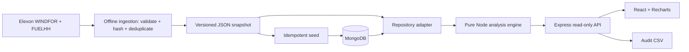

# Technical review

## Components and flow

Local production and Docker use one Node service for both React assets and API. Vercel uses static assets plus the same Express handler in a Node function. This keeps the analytic implementation identical across deployments. MongoDB is the full-stack store; the bundled-data adapter gives a reliable review experience without cloud secrets. The UI reports the actual store, and configured database errors fail visibly.

The repository loads one small immutable January dataset per process. MongoDB connections close after loading, avoiding a dangling pool per cold start. Promise caching collapses concurrent initial loads. Failed initialization clears its cache so recovery can succeed. A restart is required after seed updates. This is deliberately a pilot cache, not a continuously refreshed production ingestion architecture.

## Core design choices

- Pure functions are separate from I/O, HTTP, and charts. Tests can exercise temporal selection directly.
- Forecast indexing uses exact UTC target timestamps; vintages are sorted by publication time. For each decision, choose the last record at or before the cutoff per target hour.
- Actuals are indexed at half-hour targets. Evaluate only when both actuals exist. Every output hour carries both forecast publication and latest contributing actual publication time.
- Do not resample an hourly forecast into two apparently independent errors. Aggregate actuals to the native forecast resolution instead. Hourly energy integration is then unambiguous.
- Monthly evaluation is intentionally retrospective. The empirical risk scenario applies stricter historical eligibility and a minimum sample count. The two must not be confused.
- The 09:00 decision policy is configurable and explicitly assumed. Operational cutoffs require confirmation of the client's auction and lead time.
- Source conflicts at identical forecast or actual keys abort ingestion; output replacement occurs only once all data has validated. Hashes permit raw-response provenance checks on a refresh.
- MongoDB has unique compound indexes on `(startTime, publishTime)`. Seeding uses keyed upserts. The data is read-only to public API callers.

## Accuracy definitions

For matched hourly pairs `e = F - A`, use `mean(abs(e))`, `sqrt(mean(e²))`, `mean(e)`, and `100 × sum(abs(e)) / sum(abs(A))`. Nulls are excluded and zeros retained. WAPE's zero denominator returns null. P90 uses linear interpolation on sorted observations.

For each decision-day risk sample, retain evaluated January delivery days strictly before the decision date, and only actual pairs whose publication time is no later than the cutoff. With at least 48 hours, compute `max(0, percentile(e, .9))`. The dashed profile is a conservative scenario `max(0, F - buffer)`. This pooled historical quantile is not conditioned on forecast magnitude, weather regime, or lead time, and should not be marketed as a calibrated 90% prediction bound.

Actual revisions are not independently archived as observed by this app in January. Latest retrieved actuals with source timestamps support this pilot's replay, but stronger production claims need observed-at metadata and revision-level point-in-time selection.

## Reliability and security

There are no trading or write endpoints. Input validation constrains dates to the assignment window and cutoffs to valid 24-hour times. Responses distinguish user input errors from data failures. Public errors omit database connection details; credentials stay in environment variables. Express omits its identifying header and adds MIME-sniffing/referrer headers. Docker runs non-root and does not expose MongoDB to the host. Lockfile-based installs and GitHub Actions make checks repeatable.

The pilot does not implement authentication, authorization, persistent request auditing, rate limits, live refresh monitoring, retries for the UI beyond explicit retry, or a production CSP. Before deployment for confidential trading use, add those controls and structured operational metrics. The current dataset and app are designed for a public evaluation demo.

## Frontend

React owns decision date, cutoff, selected screen, hindsight toggle, and audit hour. Requests are cancelled logically when controls change so an older response cannot replace newer settings. The UI has loading, error/retry, missing-history, and incomplete-coverage states. The hindsight toggle resets when changing decision date. Charts render gaps rather than connecting missing observations. Keyboard-accessible inputs/buttons, native form labels, visible focus, responsive CSS, and reduced-motion handling are included. Browser/assistive-technology validation must still be recorded separately.

Charts are loaded as a separate build chunk. All business calculations live on the server; the UI converts MW to GW and formats labels. CSV exports are produced server-side with the same selection rules used by the UI.

## Review route through the code

1. `scripts/ingest.js`: acquisition, scope, validation, deduplication, source hashes.
2. `server/analytics.js`: `day()` vintage selection and actual alignment; `metrics()`; `overview()` causal buffer.
3. `tests/analytics.test.js`: edge cases and causal invariants over all real snapshot decisions.
4. `server/repository.js` and `scripts/seed.js`: explicit storage modes and MongoDB indexes.
5. `server/app.js` and `tests/api.test.js`: HTTP contract and export traceability.
6. `client/src/main.jsx`: decision workflow, hindsight boundary, error/loading states.
7. `Dockerfile`, `compose.yaml`, `vercel.json`, CI: repeatable runtime and publication configuration.

## Next iteration

Validate venue/time assumptions with the desk; ingest each publication on arrival with observed-at times; track source latency and coverage; retain actual revisions; gather a longer error sample; backtest conditional and out-of-sample uncertainty; add utility demand and contracted renewable allocation before calculating net purchases. These inputs are outside this assignment's two-dataset boundary.
