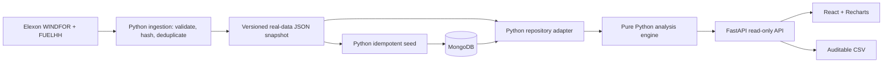

# Technical review — React + Python

## Architecture

All backend operations are Python: data acquisition, MongoDB access, analytics, HTTP endpoints, and CSV. Node is frontend build tooling only. The Docker image builds React in a Node stage and runs Python/Uvicorn as a non-root user in the final stage. Compose waits for MongoDB health, seeds it, and then starts the application. Vercel serves React statically and invokes the same FastAPI ASGI app for `/api/*`.

## Core choices

- `server/analytics.py` contains pure functions and an `Analysis` class, separate from transport and I/O.
- Forecasts are indexed by target time, and vintages sorted by publication. The latest publication at or before each decision cutoff is selected independently per target hour.
- Actuals require both half-hours and use their mean at the native forecast-hour resolution. Missing values stay null; valid zero generation is retained. The hourly actual carries the latest contributing publication timestamp.
- Monthly analysis is retrospective. The risk scenario applies a stricter historical filter: completed delivery days before the decision date and actual publication no later than its cutoff, with at least 48 paired hours.
- Source keys deduplicate by target/publication timestamps. Conflicting values at the same key fail ingestion. Both responses must validate before the snapshot is atomically replaced.
- MongoDB uses unique `(startTime, publishTime)` indexes and keyed upserts. A repeated seed preserves counts. The public API has no mutation or trading endpoint.

## Storage and concurrency

The small fixed pilot dataset is loaded once per process. An `RLock` serializes initialization so simultaneous requests cannot load duplicate copies. Only successful initialization is cached, allowing a later retry after failure. The MongoDB client closes after loading; the process retains the immutable analytical snapshot, not a permanent connection pool.

Monthly calculations are cached for up to 32 cutoff policies. API handlers are synchronous FastAPI routes, which run in its thread pool. Database loading and CPU calculations therefore do not block the ASGI event loop. Restart after reseeding; this is an explicit fixed-snapshot pilot, not a live ingestion service.

No URI means reported snapshot mode. A configured MongoDB failure returns a visible data error rather than silently substituting another store. Local and Docker MongoDB use the same PyMongo path available to Atlas deployments.

## Analysis definitions and limits

Error is `F - A`. Metrics are mean absolute error, root mean squared error, signed mean bias, and `100 * sum(abs(error)) / sum(abs(actual))`. Zero denominator returns null. Percentiles use linear interpolation.

The empirical shortfall buffer is `max(0, P90(signed errors))`. Its lower wind scenario is `max(0, F - buffer)`. It is not conditioned on weather regime, forecast magnitude, or lead time; correlated hourly samples and short January history limit interpretation. It is not a calibrated prediction interval or purchase recommendation.

Actuals are a historical extraction with source publication times, not independently archived app-observed January availability. Production replay should retain observed-at times and all actual revisions. The cutoff policy must be agreed with the desk's venue and operational lead time. National wind alone cannot determine a utility's purchases.

## HTTP, frontend, and design

FastAPI validates dates, cutoff format, hours, scopes, and duplicate query keys, and returns structured errors. Interactive OpenAPI docs are at `/api/docs`. Unknown API paths remain JSON 404 responses rather than falling through to React. CSV uses Python's standard writer and the same selection engine as the UI.

React owns date, cutoff, active view, hindsight toggle, and audit hour. An active-request guard prevents an earlier response from overwriting later control settings. Loading, retry, incomplete data, and insufficient history are visible states. Actuals require explicit hindsight reveal. Charts show gaps rather than connecting missing observations. Labels, keyboard focus, responsive navigation, and reduced-motion handling are included; browser/assistive-technology verification is recorded separately.

The visual reference is [GridBricks by REint](https://reint.ai/): Inter and Instrument Serif, warm whites, charcoal, green accents, and restrained analytical surfaces. The product remains an independently branded assessment pilot. No private GridBricks interface or proprietary source was used.

## Validation and review route

`npm run check` runs 31 pytest cases plus the React build. Tests cover causal selection, resolution alignment, missing and zero data, metric semantics, date boundaries, minimum history, actual publication eligibility, all snapshot policies, ingestion conflicts, API validation, revision eligibility, and CSV traceability.

Migration parity additionally compared every monthly output and 124 decision profiles over four cutoffs against the previous implementation. All matched within numeric tolerance. The old Node backend and tests were then removed.

CI starts the actual Docker/Python/MongoDB stack, repeats seeding, and checks the deployed API's backend identity, record counts, metrics, and served frontend using `scripts/verify_deployment.py`.

Review in this order: `scripts/ingest.py` → `server/analytics.py` → `tests/test_analytics.py` → `server/repository.py` and `scripts/seed.py` → `server/app.py` and API tests → React views → Docker/Compose/Vercel/CI configuration.

## Production extensions

Add observed-at ingestion and revision retention, live coverage/latency monitoring, longer out-of-sample uncertainty calibration, authentication/authorization, structured operational logs, rate limits, and a content security policy. Utility demand, existing commitments, renewable allocation, and trading cost/risk inputs are required before net-purchase recommendations. Those inputs are outside this assignment.
