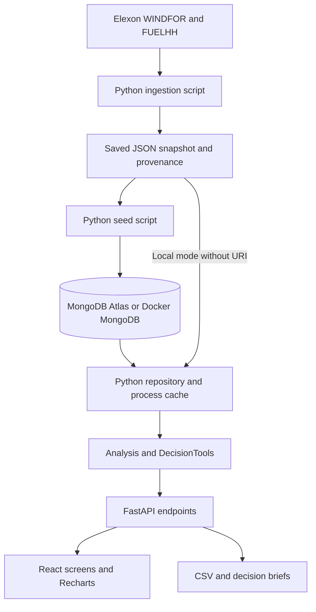

# Aeris explained — your personal project walkthrough

This is a learning script for you. Read it with the application and code open. The quoted paragraphs are sentences you can practise saying; the explanations and examples help you understand what those sentences mean.

Allow several study sessions to work through it. This document is intentionally longer than the assignment video. Use [demo-script.md](demo-script.md) for the separate, under-ten-minute submission recording.

Live app: https://aeris-bbc7a6fdf5f9.vercel.app  
Repository: https://github.com/Hargun1/bbc7a6fdf5f9

## Contents

1. [What we built](#1-what-we-built)
2. [The electricity problem](#2-the-electricity-problem)
3. [Words you need to know](#3-words-you-need-to-know)
4. [The dates and the two clocks](#4-the-dates-and-the-two-clocks)
5. [Power and energy](#5-power-and-energy)
6. [Where the data comes from](#6-where-the-data-comes-from)
7. [How we select a forecast](#7-how-we-select-a-forecast)
8. [How we prepare actual generation](#8-how-we-prepare-actual-generation)
9. [How we measure accuracy](#9-how-we-measure-accuracy)
10. [How the historical buffer works](#10-how-the-historical-buffer-works)
11. [What makes Decision Lab useful](#11-what-makes-decision-lab-useful)
12. [Every screen and export](#12-every-screen-and-export)
13. [The architecture and request journey](#13-the-architecture-and-request-journey)
14. [The code, file by file](#14-the-code-file-by-file)
15. [MongoDB, Atlas, and your environment files](#15-mongodb-atlas-and-your-environment-files)
16. [Docker explained](#16-docker-explained)
17. [Vercel explained](#17-vercel-explained)
18. [Running and checking the project](#18-running-and-checking-the-project)
19. [Tests, limitations, and development choices](#19-tests-limitations-and-development-choices)
20. [A practical study session](#20-a-practical-study-session)
21. [Questions a reviewer might ask](#21-questions-a-reviewer-might-ask)
22. [Troubleshooting and a short rehearsal](#22-troubleshooting-and-a-short-rehearsal)

## 1. What we built

> “I built Aeris, a wind-forecast decision-support portal for a Great Britain day-ahead electricity desk. It reconstructs the forecast available at a chosen decision time, measures the error against actual generation, and tests a historical wind-risk allowance.”

The application answers three questions:

1. What wind forecast could the desk have used at that time?
2. How accurate was that information when compared with what happened?
3. How did a buffer based on earlier errors perform on later delivery days?

The frontend is **React**. The entire backend is **Python/FastAPI**. The public application reads data from **MongoDB Atlas**. A local **Docker Compose** stack runs the same backend with its own MongoDB container. **Vercel** hosts the public React assets and Python API.

We consume Elexon's forecasts. We do not train a new wind-prediction model. AI assisted with research, code, design, documentation, and tests; this is disclosed in the README. AI did not invent the electricity observations.

## 2. The electricity problem

> “The client has to plan tomorrow's electricity supply today. Wind output is uncertain, so the desk needs both a forecast and an honest view of its historical errors.”

An electricity utility needs enough supply to serve its consumers. Wind depends on conditions that are not known perfectly in advance. If the desk relies on more wind than eventually arrives, it may have a supply shortfall to manage. If it relies on too little wind, it may make a different procurement decision than necessary.

The assignment gives us national wind forecasts and actuals only. We do not have the utility's demand, contracted generation, existing purchases, allocated share of national wind, or prices.

That is why Aeris shows a **wind assumption and its uncertainty**, rather than an instruction to buy a particular quantity. National wind generation is not automatically the client's own supply.

“Day-ahead” means making a decision on day D concerning delivery on day D+1. For example, the 15 January decision concerns 16 January delivery.

## 3. Words you need to know

| Term | Meaning in this project |
| --- | --- |
| Forecast | A prediction of generation for a future delivery period |
| Actual | Generation reported for the delivery period after it happens |
| Target / delivery time | The period the number describes; stored as `startTime` |
| Publication time | When the source says that record was published; `publishTime` |
| Vintage | One published version of a forecast for a target period |
| Cutoff | The last publication time allowed for a decision |
| As-of selection | Selecting records using only publications eligible at that cutoff |
| Hindsight | Looking at actual outcomes after delivery |
| Paired hour | An hour for which both forecast and aligned actual exist |
| Bias | Average signed error; it describes the direction of misses |
| Percentile | A value found from the ordered distribution of observations |
| Walk-forward replay | Repeating a policy in time order, with earlier history used for each decision |
| Snapshot | A saved, reproducible extraction of source data |
| API | The HTTP interface React calls to obtain backend results |
| Seeding | Loading the saved dataset into a database |
| Idempotent seed | Repeating the load updates matching records instead of duplicating them |
| Atlas | MongoDB's hosted database service |
| Container | A packaged runtime containing the application and its dependencies |
| Provenance | Evidence showing where data came from and how it was retrieved |

## 4. The dates and the two clocks

> “I distinguish when electricity is delivered from when its forecast became available. That distinction is essential to a fair historical replay.”

For a forecast such as this illustrative record:

```json
{
  "startTime": "2026-01-16T12:00:00.000Z",
  "publishTime": "2026-01-15T07:30:00.000Z",
  "generation": 8000
}
```

`startTime` describes the 16 January delivery hour. `publishTime` describes the forecast's publication on 15 January. The value is an illustrative 8,000 MW, not a quoted observation from our dataset.

At a 15 January 09:00 decision, that publication is eligible. A version published at 10:00 that day would be too late, even though we can retrieve it now.

The assignment says **purchase decisions made in January**, so the implemented window is:

```text
Decision dates:  1 January through 31 January 2026
Delivery dates:  2 January through 1 February 2026
Expected hours: 31 decisions × 24 delivery hours = 744
```

Delivery on 1 January would require a December decision and is outside the evaluation window. Some boundary records are retained in the extraction without becoming evaluated decisions or pre-January calibration history.

Source timestamps are normalized to UTC. UI labels use Europe/London. This particular January window is entirely GMT, so UTC and the displayed UK time agree. The code is deliberately restricted to this window; extending it to summer would require handling daylight-saving delivery days properly.

**09:00 GMT is our explicit desk assumption.** It is not presented as the universal deadline for every electricity auction. The UI also offers 09:20, 09:50, and 15:00 as analytical scenarios. The backend accepts valid `HH:mm` values for this January pilot.

## 5. Power and energy

> “I keep power and energy separate. Forecast and actual generation are compared in megawatts; energy is calculated using the duration of the delivery periods.”

- **MW** measures power, a rate of generation.
- **GW** is 1,000 MW. Some charts and cards divide MW by 1,000 for readability.
- **MWh** measures energy. An average of 1,000 MW for one hour is 1,000 MWh.
- **GWh** is 1,000 MWh.

For a complete day of one-hour forecast values:

```text
Daily forecast energy = sum(hourly forecast MW × 1 hour)
```

For example, a constant 1,000 MW across 24 hours gives 24,000 MWh, or 24 GWh. Mean power would remain 1,000 MW.

Our real 15 January / 09:00 decision has 190,330 MWh forecast energy, or 190.33 GWh. Dividing by 24 gives approximately 7,930.42 MW mean power, or 7.93 GW.

If any hourly forecast is missing, the application does not label the partial sum as complete-day energy. It returns unavailable energy. Other summaries identify the available-hour count.

## 6. Where the data comes from

> “I use only the two requested Elexon datasets. I preserve the extraction and source evidence so that the pilot can be reproduced.”

The sources are:

- [WINDFOR](https://bmrs.elexon.co.uk/api-documentation/endpoint/datasets/WINDFOR/stream): wind-generation forecasts with target and publication times.
- [FUELHH](https://bmrs.elexon.co.uk/api-documentation/endpoint/datasets/FUELHH/stream): actual generation, strictly filtered to `fuelType == "WIND"`.

See [scripts/ingest.py](../scripts/ingest.py). The ingestion path is:

```text
Download both streams → validate → normalize timestamps → deduplicate
→ save source metadata and hashes → atomically replace snapshot.json
```

The saved extraction contains **18,688 forecast records** and **1,536 WIND half-hours**, retrieved at `2026-10-24T15:36:40.466Z`. There are many forecast records because a target can have multiple publication vintages, and the extraction retains records beyond the final selected evaluation rows. These counts are not the number of evaluated hourly pairs.

The snapshot has three top-level fields:

| Field | Contents |
| --- | --- |
| `meta` | Retrieval time, decision window, source name, request URLs, raw response counts and hashes |
| `forecasts` | Normalized forecast records |
| `actuals` | Normalized WIND actual records |

`normalize()` rejects negative, nonnumeric, boolean, or non-finite generation values. It uses `(startTime, publishTime)` as a source key. Repeated identical keys with different generation values are conflicts and stop ingestion; identical duplicates collapse to one record.

Downloads have timeouts and retries. Raw responses are saved in ignored `data/raw/` for inspection. The new snapshot is written to a temporary file and replaces the old snapshot only after the downloads and normalization succeed.

The SHA-256 hashes fingerprint the raw downloaded responses. They help identify the extraction; they do not independently prove that Elexon's information was available to this application in January.

**The website does not call Elexon for fresh data every time someone visits.** It serves this fixed historical pilot dataset. There is no scheduled ingestion job in this version.

## 7. How we select a forecast

> “For every delivery hour, I select the latest forecast publication at or before the chosen decision cutoff. I do not select the latest forecast available today.”

Open [server/analytics.py](../server/analytics.py), especially `Analysis.__init__()` and `day()`.

The constructor groups forecasts by `startTime` and sorts each target's versions by publication time. For every one of the next day's 24 hours, `day()`:

1. Finds that hour's forecast versions.
2. Keeps versions with `publishTime <= decision cutoff`.
3. Selects the last eligible version.
4. Leaves the forecast missing if no version is eligible.

Illustrative versions for one target:

| Publication on decision day | Forecast MW | At a 09:00 cutoff |
| --- | ---: | --- |
| 07:30 | 8,000 | Eligible, superseded |
| 08:30 | 7,500 | Eligible, superseded |
| 09:00 | 7,700 | Selected: equality is allowed |
| 10:00 | 9,000 | Excluded: too late |

Using the 10:00 version in the 09:00 replay would introduce **look-ahead leakage**: the desk would be credited with information it did not yet have.

Selection happens separately for each delivery hour. A day's selected profile can legitimately contain different publication timestamps. A “latest publication” summary alone does not describe every hour, so the audit and oldest-age indicator matter.

Two time measurements are different:

```text
Forecast age at decision = cutoff − publication time
Forecast lead time      = target time − publication time
```

They answer “How old was our information?” and “How far ahead was this prediction made?” respectively.

## 8. How we prepare actual generation

> “The retrieved forecasts are hourly, while actuals are half-hourly. I compare each hourly forecast with the mean of both corresponding half-hour actuals.”

For an illustrative 12:00 delivery hour:

```text
12:00 half-hour actual = 6,000 MW
12:30 half-hour actual = 8,000 MW
Hourly actual         = (6,000 + 8,000) / 2 = 7,000 MW
```

Adding the two readings and comparing 14,000 MW with the hourly forecast would be a unit/alignment mistake. The equivalent hourly energy is `6,000 × 0.5 + 8,000 × 0.5 = 7,000 MWh`.

Both half-hours must exist. Missing readings stay missing; the code does not interpolate or forward-fill. A genuine value of zero remains valid.

The analysis retains the latest retrieved actual revision for each half-hour. The hourly actual publication timestamp is the later publication of its two contributing readings.

This is a historical extraction with source publication timestamps, not a database independently recorded by us during January. We do not retain a complete as-observed actual revision archive. That limits how precisely we can reconstruct historical availability.

## 9. How we measure accuracy

> “I evaluate the same as-of forecast selected for the decision, using matched hourly actuals. Error is forecast minus actual, so positive error means wind was overforecast.”

Open `metrics()` in [server/analytics.py](../server/analytics.py).

```text
Error e = forecast F − actual A
```

If the forecast is 8,000 MW and actual is 6,500 MW, error is +1,500 MW. The wind assumption exceeded actual generation. If actual is 9,000 MW, the error is −1,000 MW.

Only rows containing both a forecast and an aligned actual enter the metrics.

| Metric | Formula | What it tells you |
| --- | --- | --- |
| MAE | `sum(abs(e)) / n` | Average size of the miss, in MW |
| RMSE | `sqrt(sum(e²) / n)` | Error measure that gives larger misses more influence, in MW |
| Bias | `sum(e) / n` | Average direction of error, in MW |
| WAPE | `100 × sum(abs(e)) / sum(abs(A))` | Absolute error relative to total actual generation, in percent |
| P90 absolute error | 90th percentile of `abs(e)` | A descriptive upper-tail error magnitude for this sample |

An illustrative three-hour example:

| Hour | Forecast MW | Actual MW | Signed error MW | Absolute error MW |
| --- | ---: | ---: | ---: | ---: |
| 1 | 1,000 | 900 | +100 | 100 |
| 2 | 1,000 | 1,200 | −200 | 200 |
| 3 | 1,000 | 700 | +300 | 300 |

The resulting MAE is 200 MW, RMSE is about 216.02 MW, bias is +66.67 MW, and WAPE is about 21.43%. Bias is smaller than MAE because positive and negative errors partly cancel. Bias alone cannot describe accuracy.

`quantile()` sorts the values and interpolates at position `(n − 1) × probability`. For absolute errors `[100, 200, 300]`, P90 is 280 MW under that convention. An empty sample produces unavailable metrics; WAPE is unavailable when its denominator is zero.

The real saved dataset at 09:00 gives:

| Measure | Value |
| --- | ---: |
| Paired hours | 744 / 744 |
| MAE | 2,038.91 MW |
| RMSE | 2,504.76 MW |
| Bias | +1,747.89 MW |
| WAPE | 18.07% |
| P90 absolute error | 4,097.90 MW |

These are descriptive January results. WAPE of 18.07% is not a statement that the forecast has “81.93% guaranteed accuracy.” Reproduce the table with `python -m scripts.report`.

## 10. How the historical buffer works

> “The desk's dashed line is a historical scenario. I estimate it using completed earlier delivery days whose actual publication was available by the current decision cutoff.”

Open `historical_rows()` and `overview()` in [server/analytics.py](../server/analytics.py).

For a 15 January decision, history must satisfy all these conditions:

- Delivery date is strictly before 15 January: the current day is excluded.
- Forecast and actual both exist.
- The contributing actual publication timestamp is at or before the current cutoff.
- Forecasts for those earlier decisions were themselves selected using the same cutoff-time policy.

Only the January evaluation history is used. In this example, eligible history covers deliveries 2–14 January: 13 days × 24 = **312 hourly pairs**.

The default desk scenario requires at least 48 prior pairs and computes:

```text
buffer       = max(0, P90(prior signed errors))
lower wind   = max(0, selected forecast − buffer)
```

There are two floors. The buffer cannot be negative, and the lower wind scenario cannot be negative. If there are fewer than 48 prior pairs, the buffer is unavailable; lack of evidence does not become a zero buffer.

For the real 15 January / 09:00 decision, the historical buffer is **4,376.5 MW**, or about 4.38 GW. With an illustrative 8,000 MW hourly forecast, lower wind would be `8,000 − 4,376.5 = 3,623.5 MW`.

**P90 absolute error and the P90 signed-error buffer are different calculations.** The accuracy screen describes the size of misses in either direction; the risk scenario focuses on the overforecast side by using signed errors. The samples also differ: the monthly accuracy screen can use the whole evaluated month, while a decision's buffer uses eligible earlier history only.

48 hours is a transparent pilot threshold, not proof that the distribution is stable. The pooled percentile is not conditioned on weather, output level, or forecast lead time, and it is not a calibrated prediction interval.

## 11. What makes Decision Lab useful

Open [server/decision_tools.py](../server/decision_tools.py) and [client/src/DecisionLab.jsx](../client/src/DecisionLab.jsx).

### A. Forecast revisions

> “I compare the forecast available at an earlier information snapshot with the selected cutoff, so the desk can see exactly what changed.”

For each delivery hour, revision is `later forecast − earlier forecast`. The selected-day curves use forecast publications only. The lab reports changed-hour count, the largest nonzero revisions with publication times, and full-day energy revision when all 24 hours are comparable. An unchanged profile is distinguished from missing comparable data.

### B. Fair comparison of cutoff policies

> “For retrospective accuracy comparisons, both policies are scored on the exact same target hours and actuals.”

Imagine the earlier policy has forecasts for only 10 easy hours, while the later one has all 24 hours. Comparing their separate averages could reward missing difficult hours. We instead use the common cohort where both forecasts and the actual exist.

For the real 07:00 versus 09:00 comparison, both have 744 matched hours:

```text
07:00 MAE = 2,016.12 MW
09:00 MAE = 2,038.91 MW
Change    = +22.79 MW
```

Later information was worse on MAE in this sample. Other metrics can move differently; for example, 09:00 has lower RMSE here. The portal does not assume that later always means better, and it does not advise waiting beyond a real trading deadline.

### C. Chronological validation of P80, P90, and P95

> “I replay each decision in time order, freeze its eligible history, calculate its buffer, and evaluate that scenario on the following delivery day.”

For each decision, `backtest()` calculates a fresh historical buffer with the chosen percentile. It then forms the clipped lower wind scenario for that decision's delivery hours and compares it with actual generation.

```text
Covered hour:         actual >= lower wind scenario
Breach:               actual < lower wind scenario
Observed coverage:    100 × covered hours / evaluated hours
Wind discounted:      forecast − lower wind scenario
Residual shortfall:   max(lower wind scenario − actual, 0) × 1 hour
```

“Average wind allowance” is the total discounted wind energy divided by evaluated hourly duration. Because lower wind is clipped at zero, the discounted amount can be smaller than the raw buffer.

At 09:00, the first three decision days lack the minimum history and are excluded. The 4 January decision is the first eligible one: it has completed deliveries on 2 and 3 January as history. This leaves **28 decisions and 672 evaluated hours**.

| Policy | Observed coverage | Average wind allowance | Residual shortfall |
| --- | ---: | ---: | ---: |
| P80 | 78.42% | 3.09 GW | 217.97 GWh |
| P90 | 87.80% | 4.00 GW | 119.42 GWh |
| P95 | 90.77% | 4.79 GW | 74.48 GWh |

P90 has 82 breaches: `(672 − 82) / 672 × 100 = 87.7976%` observed coverage. P95 increases coverage while reducing the wind assumed available more heavily. These are national-wind scenario statistics, not measured utility purchases, costs, or savings.

Do not confuse **data coverage** with **scenario coverage**. The accuracy screen has 744/744 matched data hours; the P90 replay covers 590/672 evaluated hours under its lower scenario.

January is the evaluation sample. Choosing whichever percentile looks best after inspecting January can overfit that sample. Adjacent hours are correlated; future coverage is not guaranteed.

### D. Error atlas and decision brief

The atlas has 31 decision-date rows and 24 delivery-hour columns. It colors signed error, distinguishes missing values, and lets you inspect an hour and open its publication audit. Arrow keys move focus; Enter/Space selects a cell.

The brief is a separate **as-of decision record**. It includes selected forecasts, historical buffer/sample, revision summary, cutoff, and provenance. It excludes the selected delivery day's actual readings, error metrics, and even its hindsight paired-hour count.

The JSON record is serialized with sorted keys and hashed with SHA-256; the first 16 hexadecimal characters become its reproducible ID. The ID fingerprints the record, including retrieval metadata. It is not a digital signature or tamper-proof ledger.

[server/brief.py](../server/brief.py) escapes dynamic text and produces self-contained HTML without scripts or external resources. The downloaded HTML can be printed or saved as PDF through the browser. There is no server-side PDF-generation library or saved-report database collection.

## 12. Every screen and export

### Day-ahead desk

> “This is the decision view: tomorrow's selected wind profile, key summaries, information age, and historical lower-wind scenario.”

Choose a January decision date and cutoff. The cards show mean forecast, full-day energy, historical P90 buffer, and peak forecast. The chart shows the selected profile and, when history is sufficient, the lower scenario. The profile uses GW axis labels; tooltips provide MW values.

Actuals are hidden on the main profile until you choose **Reveal actuals — Hindsight**. This is a presentation safeguard, not an access-control boundary: the historical API response already contains actuals. The tab is not a secure simulation environment hiding outcomes from a determined user.

### Forecast accuracy

This is explicitly retrospective. It shows monthly metrics, daily scorecards, error charts, hourly analysis, and paired-data counts. Selecting a decision date lets you inspect its profile. Changing cutoff recomputes the information policy used across the month.

### Decision lab

The parent date/cutoff select the decision. The lab adds an earlier snapshot and percentile selector. Its revision chart is as-of information; its policy scorecard, replay results, and error atlas use hindsight. Changing the lab percentile does not change the desk's fixed default P90 policy.

### Data & provenance

Inspect record counts, storage mode, retrieval evidence, source request hashes, and all retained forecast versions for a chosen delivery hour. Versions published after the cutoff remain visible as excluded evidence. They are not used in the selected profile.

### Methodology

Read the selection rules, timeline, metric definitions, aggregation, cutoff assumption, risk interpretation, and limits. It gives the reviewer a place to check what the numbers mean.

### CSV and brief exports

The top CSV export is monthly on Forecast accuracy and daily on other tabs. It includes actuals and errors retrospectively, even if actuals are hidden on the desk chart. It also includes publication times, lead time, cutoff, decision date, and retrieval timestamp.

Decision Lab's brief download has the stricter as-of field list described above. `/api/brief?format=json` returns the machine-readable record; the default format downloads HTML.

## 13. The architecture and request journey

> “I separate acquiring data, storing it, calculating results, and presenting those results. The same Python analysis logic serves all screens and exports.”



There are two journeys:

**Acquisition journey:** a developer runs ingestion, then seeds MongoDB. This changes the stored dataset. It is not triggered by a website visitor.

**Request journey:** a user opens the website or changes settings. React requests API results. FastAPI obtains the analysis instance, calculates/looks up results, and returns JSON. React turns the JSON into cards and charts.

For example, selecting 15 January / 09:00 causes React to request overview and monthly accuracy. The selected audit hour has its own revisions request. Opening Decision Lab also requests `/api/lab` with the date, cutoff, earlier snapshot, and percentile.

The repository loads data **once per Python process** after successful initialization. It closes its MongoDB client after loading and retains the analysis data in memory. Subsequent requests to that process use the cached snapshot. A new serverless instance loads its own copy; this is not a globally shared cache.

An `RLock` prevents simultaneous initial requests from duplicating initialization. Failed initialization is not cached. Monthly results have an additional `lru_cache(maxsize=32)` keyed by cutoff policy. After reseeding, restart/redeploy the API so it loads the new dataset.

## 14. The code, file by file

### Frontend

| File | What to look for |
| --- | --- |
| [client/index.html](../client/index.html) | The HTML entry and root element for React |
| [client/src/main.jsx](../client/src/main.jsx) | App state, API requests, navigation, desk, accuracy, provenance, methodology |
| [client/src/DecisionLab.jsx](../client/src/DecisionLab.jsx) | Lab controls, comparisons, replay charts, atlas focus/selection, brief link |
| [client/src/styles.css](../client/src/styles.css) | Main layout, typography, colors, chart containers, responsive and reduced-motion rules |
| [client/src/decision-lab.css](../client/src/decision-lab.css) | Layout and responsive rules specific to the lab |
| [vite.config.js](../vite.config.js) | React build configuration, `/api` development proxy, separate charts bundle |

`createRoot(...).render(<App />)` mounts React. `useState` tracks the active tab, decision date, cutoff, results, loading/error states, hindsight toggle, audit hour, and mobile navigation.

`useEffect` requests data when relevant settings change. Overview and accuracy requests are started together using `Promise.all`. Each effect has an `active` flag that cleanup sets to false, so a slow old response cannot overwrite a newer selection. This ignores stale responses; it does not cancel the underlying network request.

The lab has its own earlier-cutoff, percentile, selected-cell, focus, and retry state. `useRef` gives it access to the atlas container for keyboard focus movement. Its `onInspect` callback sends a selected date/hour back to the parent, which opens the provenance view.

The app uses React state for its tabs rather than React Router. Controls are not persisted as URL parameters or user preferences. Most original views remain in one large `main.jsx`; extracting more components would be a useful maintainability improvement.

Recharts renders the graphs. Lucide supplies icons. CSS takes visual cues from GridBricks by REint: greens, warm neutrals, Inter, and Instrument Serif. Aeris is an independent assessment implementation. This frontend uses JavaScript/JSX, not TypeScript.

### Core Python analytics

| Function or method in [server/analytics.py](../server/analytics.py) | Responsibility |
| --- | --- |
| `timestamp()` / `iso()` | Parse timestamps and produce consistent UTC strings |
| `cutoff_for()` | Validate the January decision date/time and construct a cutoff timestamp |
| `quantile()` | Calculate linearly interpolated empirical percentiles |
| `metrics()` | Filter paired rows and compute MAE, RMSE, bias, WAPE, and P90 absolute error |
| `Analysis.__init__()` | Index forecast vintages and select the latest retrieved actual revisions |
| `day()` | Build 24 aligned target hours using as-of forecast selection |
| `month()` | Combine 31 decisions, daily metrics, monthly metrics, and hour-of-day summaries |
| `historical_rows()` | Filter prior completed deliveries and publication-eligible actuals for a decision |
| `overview()` | Add summaries, default P90 risk information, lower scenario, and metadata |
| `revisions()` | Return all versions for one target with cutoff eligibility labels |

These calculations do not make HTTP requests or write to MongoDB. Keeping calculations separate from transport/storage makes them easier to test.

In [server/decision_tools.py](../server/decision_tools.py), `risk()` supports P80/P90/P95, `compare()` builds revision and common-cohort results, `backtest()` runs the chronological replay, `lab()` assembles the lab response, and `brief()` enumerates the permitted report fields and computes its ID.

### Storage and API

[server/repository.py](../server/repository.py) chooses the storage source. With `MONGODB_URI`, it reads `forecasts`, `actuals`, and the snapshot metadata from MongoDB. Without a URI, it reads `data/snapshot.json`. It returns the analysis instance, underlying snapshot, and explicit storage-mode label.

A configured database failure does not silently switch to local data. The application returns a visible failure instead of disguising a broken database connection as success.

[server/app.py](../server/app.py) creates the FastAPI app and defines these interfaces:

| Endpoint | Purpose |
| --- | --- |
| `/api/health` | Backend/version/storage identity and extraction timestamp; it initializes the repository |
| `/api/overview?date=2026-01-15&cutoff=09:00` | One decision profile, summary, history, and default risk scenario |
| `/api/accuracy?cutoff=09:00` | All January decision metrics and rows for that policy |
| `/api/revisions?date=2026-01-15&cutoff=09:00&hour=12` | Retained versions for a delivery hour |
| `/api/lab?date=2026-01-15&cutoff=09:00&earlier=07:00&confidence=90` | Revision comparison, replay, selected risk, and atlas |
| `/api/export?scope=month&cutoff=09:00` | CSV download; `scope=day` is also supported |
| `/api/brief?date=2026-01-15&confidence=90` | Printable HTML attachment; `format=json` returns the record |
| `/api/docs` | Interactive API documentation |
| `/api/openapi.json` | API schema |

Defaults are decision 15 January, cutoff 09:00, earlier snapshot 07:00, and lab percentile 90. Validation rejects malformed supported inputs, repeated recognized query keys, invalid confidence values, and comparisons where the earlier cutoff is not strictly earlier.

Bad inputs produce JSON HTTP 400 responses. Unknown API paths return JSON 404. The broad unexpected-error handler returns a generic 503 and logs the exception type; it does not expose connection strings or a traceback to visitors. General response headers include `nosniff` and a referrer policy. The HTML brief also has its own restrictive content security policy.

The handlers doing analysis/database work are synchronous functions, which FastAPI runs in its thread pool. CPU work is still CPU work: this is not a claim of unlimited parallelism.

### Scripts and configuration

| File | Purpose |
| --- | --- |
| [scripts/ingest.py](../scripts/ingest.py) | Download, validate, normalize, deduplicate, hash, and replace the source snapshot |
| [scripts/seed.py](../scripts/seed.py) | Create unique indexes and upsert data into the selected MongoDB database |
| [scripts/report.py](../scripts/report.py) | Reproduce monthly metrics from the bundled snapshot at four cutoffs |
| [scripts/verify_deployment.py](../scripts/verify_deployment.py) | Compare a running API with local reference calculations and check storage/frontend |
| [server/brief.py](../server/brief.py) | Render the printable, escaped HTML report |
| [api/index.py](../api/index.py) | Export the existing FastAPI `app` for Vercel; it is not a second backend |
| [server/__init__.py](../server/__init__.py), [scripts/__init__.py](../scripts/__init__.py) | Mark the Python packages used by imports and `python -m ...` commands |
| [package.json](../package.json) | Frontend dependencies and convenient commands that also launch Python |
| [package-lock.json](../package-lock.json) | Record resolved npm dependency versions used by reproducible `npm ci` installs |
| [requirements.txt](../requirements.txt) | FastAPI, Uvicorn, PyMongo |
| [requirements-dev.txt](../requirements-dev.txt) | Runtime dependencies plus pytest and HTTP testing support |
| [pyproject.toml](../pyproject.toml), [.python-version](../.python-version) | Project metadata, Python 3.13 requirement, pytest configuration |
| [.github/workflows/check.yml](../.github/workflows/check.yml) | Automated Python, React, Docker, MongoDB, and parity checks |
| [.gitignore](../.gitignore) | Keep local secrets, dependencies, caches, and raw downloads out of Git |
| [.dockerignore](../.dockerignore), [.vercelignore](../.vercelignore) | Exclude secrets and unnecessary files from build/deployment uploads |
| [.gitattributes](../.gitattributes) | Repository line-ending rules |

Node.js is used by Vite and npm tooling. There is no Express backend and no Mongoose layer in this implementation. Python talks to MongoDB through PyMongo.

Generated folders are different from source code. `node_modules/` contains installed frontend dependencies; `dist/` is the compiled frontend output; `.vercel/` holds local deployment-tool state; `__pycache__/` and `.pytest_cache/` are Python/test caches. You do not need to study those folders to understand the application. `data/raw/` holds ignored source downloads, while the tracked `data/snapshot.json` is the reproducible dataset. `docs/` contains the explanation, recording, methodology, architecture, and verification records.

## 15. MongoDB, Atlas, and your environment files

> “MongoDB stores the historical source records, and Python performs the analysis. Atlas is the hosted MongoDB instance used by the public application.”

The selected application database contains:

| Collection | Purpose | Current pilot count |
| --- | --- | ---: |
| `forecasts` | Forecast vintages with target, publication, generation | 18,688 |
| `actuals` | WIND half-hours with target, publication, generation | 1,536 |
| `metadata` | One document with `_id: snapshot` containing extraction provenance | 1 |

The forecasts/actuals have unique compound indexes on `(startTime, publishTime)`. A compound index identifies records using both fields together. A forecast for the same target published later is a separate vintage, not a duplicate of the earlier publication.

The seed uses `UpdateOne(..., upsert=True)`: matching keys are updated, and missing keys are inserted. Seeding the same snapshot twice preserves the counts. It is an upsert loader, not a complete delete-and-replace synchronization: records absent from a later source snapshot are not automatically removed.

No user accounts, trade orders, saved preferences, or report-history collections are implemented. MongoDB stores the input records; most analytical results are calculated in Python and cached in process.

Your environment files have different roles:

| File / setting | Role |
| --- | --- |
| `.env.example` | Tracked example configuration; no real credentials belong here |
| `.env.atlas.local` | Ignored local Atlas connection setting used during setup |
| `.env.local` | Ignored local environment file; Vercel tooling may place authentication-related settings here |
| Vercel production `MONGODB_URI` | Hidden Secret supplied to the deployed Python runtime |
| Compose `MONGODB_URI` | Private address `mongodb://mongo:27017/aeris` for the local stack |

An environment variable is a setting available to a running process. Merely saving a file does not automatically load that setting into every program. The project's native Python startup commands do not parse `.env.atlas.local` by themselves. Setup loaded the URI privately when seeding Atlas and passed it to Vercel through stdin.

Keep credentials out of screenshots, recordings, commits, frontend code, and `VITE_*` settings. You can explain the environment variable's **name and purpose** without showing its value. A source hash or report ID is not a database credential.

## 16. Docker explained

> “Docker packages the build/runtime, and Compose defines how the database, seed job, and application start together.”

Open [Dockerfile](../Dockerfile) and [compose.yaml](../compose.yaml).

The Dockerfile has two stages:

1. **Build stage:** Node 22 installs frontend dependencies and builds React into `dist`.
2. **Runtime stage:** Python 3.13 installs backend dependencies, receives the compiled assets, backend/scripts, and snapshot, then runs Uvicorn as a non-root user.

The final runtime does not need Node to serve the site. Uvicorn is the server process that runs the FastAPI application. It binds port 3001, and FastAPI serves both `/api` responses and compiled React files locally in this image.

Compose defines three services:

| Service | Job | Expected state after startup |
| --- | --- | --- |
| `mongo` | MongoDB 7 with a ping health check and named data volume | Running and healthy |
| `seed` | One-time Python data/index load after MongoDB is healthy | Exited with code 0 |
| `app` | Python API and built React site, after successful seeding | Running and healthy |

The seed container exiting successfully is normal. It is a completed job, not a crashed web server.

The app connects to the hostname `mongo` on the private Compose network. `localhost` inside the app container would mean the app container itself. Only application port 3001 is published to the host; MongoDB is not published as a host database port.

The project name is `aeris`. The named `mongo-data` volume survives container recreation and `docker compose down`. Explicitly removing the volume would delete this local database, so normal stop/start instructions retain it.

The application's Docker health check calls `/api/health`. CI uses a separate project name, `aeris-ci`, so it can create and clean up its own stack independently.

Full operating commands are in [docker-mongodb.md](docker-mongodb.md).

## 17. Vercel explained

> “The public deployment serves React statically and runs the same Python FastAPI app as a serverless function. Its database is MongoDB Atlas.”

Open [vercel.json](../vercel.json) and [api/index.py](../api/index.py).

Vite builds the frontend into `dist`. Vercel serves those assets. Requests under `/api/*` are rewritten to the Python entrypoint, which imports the existing FastAPI app. Other non-asset paths are rewritten to the frontend entry HTML.

The production Python runtime receives `MONGODB_URI` as a hidden Secret. It loads the seeded data from Atlas and uses the same analysis functions as Docker. It does not connect to the MongoDB container on your laptop.

**Vercel is not running our Compose stack or Dockerfile for this deployment.** Docker is the separately verified local/CI packaging path. The two paths share Python source code and analytical definitions.

The release procedure stages a production build without assigning public domains, checks it, and then promotes that production build. The public hostname is the short app URL at the beginning of this guide. Team/deployment-specific URLs can require Vercel authentication.

A cold serverless process loads data from Atlas; a warm process reuses its cached analysis instance. “Hosted online with Atlas” does not mean “continuously refreshing January data.” No Render service is needed or configured for this setup.

## 18. Running and checking the project

### Easiest full local stack

Start Docker Desktop with Linux containers, then run from the repository root:

```powershell
docker compose up -d --build app
docker compose ps --all
```

Open http://localhost:3001. The API documentation is http://localhost:3001/api/docs.

Verify the containerized MongoDB-backed application:

```powershell
docker compose exec -T app python -m scripts.verify_deployment
```

The verification compares API outputs with the same saved reference data and requires MongoDB by default. It checks identity, source counts, metrics, replay, brief ID, and served frontend.

### Native development with hot reload

Stop the Docker app first if it already occupies port 3001:

```powershell
docker compose stop app
python -m pip install -r requirements-dev.txt
npm ci
npm run dev
```

Use Python 3.13 and Node 22 or later. Open http://127.0.0.1:5173. Vite runs the frontend development server, and Uvicorn runs the backend on port 3001. Vite proxies `/api` requests to that backend, so the browser uses a single development origin.

Without a process-level `MONGODB_URI`, native Python uses the bundled snapshot. If the shell already has a URI set, that setting takes effect. The saved `.env.atlas.local` file alone does not set it.

### Read-only learning checks

```powershell
python -m scripts.report
```

This reproduces the four cutoff metric tables from the local snapshot without writing to Atlas or downloading new data.

```powershell
$env:TEST_BASE_URL = 'https://aeris-bbc7a6fdf5f9.vercel.app'
$env:REQUIRE_MONGO = '1'
python -m scripts.verify_deployment
```

This checks the public application. It does not require putting the Atlas password into the shell: it reads public API responses, while the deployed backend holds its own credential.

### Development checks and maintenance

```powershell
npm run check
```

This runs pytest and the frontend production build. `npm run build` alone builds React; `npm start` runs Python and serves an existing `dist` locally.

`python -m scripts.ingest` refreshes the source snapshot, and `python -m scripts.seed` writes to the database selected by the process's `MONGODB_URI`. These are maintenance actions, not required just to read the project. A source refresh, database load, and API restart/redeployment are separate steps.

## 19. Tests, limitations, and development choices

> “I test the rules that could change the conclusion: which publication was eligible, which hours were paired, whether future observations leak into history, and whether both policies are evaluated fairly.”

The suite currently has **55 pytest cases**, including parameterized cases. That does not mean 55 separate test functions or 55 browser tests.

| File | Main checks |
| --- | --- |
| [tests/test_analytics.py](../tests/test_analytics.py) | Cutoff equality, later exclusion, aggregation, missing/zero data, metric units/signs, dates, history, real-data invariants, ingestion validation |
| [tests/test_api.py](../tests/test_api.py) | Health, overview, input errors, CSV provenance, revisions, unknown routes |
| [tests/test_decision_tools.py](../tests/test_decision_tools.py) | Common cohorts, unchanged revisions, chronological replay, history exclusions, clipping, brief isolation/ID, HTML escaping, lab endpoints |

One important regression test removes future actual observations and confirms that an earlier decision's risk and brief do not change. Other tests use small artificial fixtures to make edge cases predictable; the application's published observations come from Elexon.

CI installs Node/Python dependencies, runs tests/build, builds the real Compose stack, seeds MongoDB, repeats the seed, verifies the running API, prints container diagnostics, and removes its isolated stack/volumes. Atlas and public Vercel checks were also performed separately during setup. Verification evidence is in [submission.md](submission.md) and [publication.json](publication.json).

Why these choices are reasonable for this pilot:

- React/Recharts make the interactive information policy and error charts straightforward.
- Python keeps analytical rules, acquisition, HTTP, and database access in one backend language.
- FastAPI provides the HTTP application and interactive API docs.
- MongoDB fits the timestamped source records and required vintage indexes; it is not the only database that could solve the problem.
- A saved snapshot plus Atlas supports reproducibility, offline local startup, and an actual hosted database path.
- Process caching is simple for this small fixed month, with the explicit tradeoff that refreshes require restart/redeploy.
- The empirical buffer is transparent and testable. A more complicated model would need additional evidence and validation to justify it.

Know the boundaries before a reviewer asks:

1. We use national Elexon wind, not all renewables or a client's portfolio. No demand/prices/contracts are included.
2. The source extraction happened in October. Publication timestamps are an availability proxy; actual revision history is incomplete for a perfect January reconstruction.
3. The current latest actual revision can exclude a historical training hour if its publication is too late; we cannot automatically recover an earlier revision we did not retain.
4. This is a fixed January replay with a pooled error scenario, not live trading or an independently trained forecast model.
5. A higher historical percentile does not establish the cheapest or best procurement strategy. Costs and decision objectives are outside the data supplied.
6. There is no app login, portfolio authorization, order execution, scheduled ingestion, or report-history persistence.
7. Response validation and tests do not replace operational monitoring, load testing, or longer out-of-sample evaluation.
8. Browser visual, accessibility-device, and incognito checks were not completed by the available automation. Verify the actual submission URLs manually before submitting.

## 20. A practical study session

Use this sequence rather than trying to memorize every sentence at once:

1. Open the desk at 15 January / 09:00. Explain why delivery is 16 January. Locate the 07:30 publication, 7.93 GW mean, 190.33 GWh energy, 10.375 GW peak, and 1.5-hour oldest forecast age.
2. Explain why the 4.38 GW buffer comes from 312 earlier pairs, not the whole month's 744 outcomes. Read `historical_rows()` and trace its filters.
3. Reveal actuals and explain the sign of an overforecast error. Open Forecast accuracy and reproduce the monthly table with `scripts.report`.
4. In Decision Lab, compare 07:00 and 09:00. Explain why common cohorts matter and why the later policy's MAE is not automatically lower.
5. Change P90 to P95. Explain both the coverage improvement and the larger wind allowance. Explain why 672, not 744, hours enter this replay.
6. Select an atlas cell, inspect its signed error, and open the original hour's publication audit. Confirm that excluded later versions remain visible as evidence.
7. Download a brief. Open it locally, inspect the forecast/publication columns and ID, and explain why there are no delivery-day actual readings. Try Print / Save as PDF yourself.
8. Trace `/api/overview` from `main.jsx` to `server/app.py`, `get_repository()`, and `Analysis.overview()`.
9. Open `scripts/seed.py`. Explain the compound key, upsert, metadata document, and why repeated seeding preserves counts.
10. Open Dockerfile, Compose, and Vercel config. Draw the two hosting paths and identify where MongoDB runs in each.
11. Read the future-actual isolation test. Explain what failure it would catch and one limitation it cannot solve, such as missing actual revision history.
12. Practise the short rehearsal below without looking at notes. If a term feels unclear, return to its worked example.

## 21. Questions a reviewer might ask

**“Are you predicting wind with AI?”**  
No. The application consumes Elexon WINDFOR predictions and analyzes their historical errors. AI assisted in developing the software and documentation.

**“What exactly does latest mean?”**  
The latest eligible publication for each target hour at the chosen cutoff. It does not mean the latest version currently retrievable from the source.

**“Why does the evaluation include February?”**  
31 January is an in-scope decision date whose day-ahead delivery is 1 February. The window is defined by decision dates.

**“Why average actuals rather than add them?”**  
Each half-hour value is power in MW. Their equal-duration average aligns with one hourly power forecast. Energy would multiply each reading by half an hour before adding.

**“What happens when data is missing?”**  
Null remains unavailable, zero remains valid, unpaired hours are excluded from accuracy, and full-day energy is withheld if forecasts are incomplete.

**“Why not report bias alone?”**  
Opposite errors can cancel. MAE and RMSE quantify magnitude; bias describes direction. The UI presents them together.

**“Does P90 guarantee 90% coverage?”**  
No. It is an empirical percentile rule. The chronological January replay observed 87.8% coverage over 672 eligible hours; this does not guarantee future coverage.

**“Why exclude the first three decisions?”**  
There are fewer than 48 prior completed paired hours within the pilot history. The first eligible decision is 4 January, after deliveries on 2 and 3 January are completed.

**“Why exclude the current decision day from history?”**  
The implementation uses fully completed earlier delivery days for a simple, consistent training rule. It does not mix a partially observed current day into the calibration sample.

**“What evidence supports no look-ahead?”**  
Forecast selection gates publication time; historical risk filters delivery/publication dates; tests cover equality, later exclusion, and future-actual removal. The source's historical revision limitation remains disclosed.

**“Did the 09:00 forecast improve on 07:00?”**  
It had approximately 22.79 MW worse MAE on the common 744-hour sample, but lower RMSE. The answer depends on the metric, and neither result establishes a trading recommendation.

**“Why MongoDB?”**  
The normalized source records and multiple vintages fit document collections with a unique target/publication key. PyMongo provides the Python adapter. SQL would also be a reasonable design; MongoDB is not essential to the percentile mathematics.

**“Is every request a MongoDB query?”**  
No. Each successful Python process initialization loads and caches the small dataset. Later requests reuse it. New serverless instances load their own copies.

**“Is the public app running inside Docker?”**  
The public Vercel deployment uses static assets and a Python function connected to Atlas. Docker/Compose is the separate local and CI path using the same source.

**“Can the React browser connect directly to Atlas?”**  
The implemented browser calls FastAPI. Python holds the server-side database setting. The Atlas URI is not shipped to the React bundle.

**“Does hiding actuals mean they are absent from the API?”**  
No. It is a hindsight presentation toggle. The separate brief deliberately restricts its fields so future actual readings are absent from that exported record.

**“Is the brief ID a security signature?”**  
No. It is a short deterministic hash-derived fingerprint for reproducibility. It does not authenticate a signer or establish an immutable audit ledger.

**“Can the app tell us how much electricity to buy?”**  
It can inform the wind component of that decision. Utility demand, portfolio allocation, existing commitments, prices, and risk objectives are required to calculate a purchase quantity.

**“What would you improve first?”**  
Agree the desk's actual timing/portfolio requirements, retain observed-at source data and revision history, then evaluate uncertainty on a longer untouched time period. Production monitoring and appropriate user access would follow the deployment requirements.

**“What did you use AI for?”**  
Codex assisted with research, implementation, design, tests, and documentation, as disclosed. Explain the resulting code and its limits in your own words, and distinguish what you have personally verified from setup evidence recorded in the repository.

## 22. Troubleshooting and a short rehearsal

| Symptom | What to check |
| --- | --- |
| Docker says it cannot connect to the engine | Start Docker Desktop and select Linux containers |
| Port 3001 is already in use | Stop the Docker app before native development, or stop the native server before Docker |
| `seed` is shown as exited | Exit code 0 is expected for the completed one-time job; inspect logs for a nonzero exit |
| Native app reports snapshot storage | The Python process has no URI; saving a local env file alone does not load it |
| App returns 503 after configuring MongoDB | Check URI formatting, database credentials, Atlas network access/cluster state, and whether the database was seeded; do not print credentials |
| A database update is not reflected in the UI | Restart/redeploy the API to replace its cached analytical snapshot |
| Early January has no dashed risk line | There is insufficient eligible history; it is not automatically a calculation error |
| A brief download says the earlier cutoff is invalid | The earlier snapshot must be strictly before the selected cutoff |
| CSV includes actuals while the desk hides them | CSV is a retrospective export; use the decision brief for the restricted as-of record |
| Deployment-specific URL requests a login | Use the public production URL for submission; previews can remain protected |

Practise saying this after you understand the sections above:

> “Aeris helps a day-ahead electricity desk understand which national wind forecast was available at its decision cutoff and how that forecast performed. I use only Elexon's WINDFOR and WIND-filtered FUELHH data. I align hourly forecasts with the mean of the two half-hour actuals, select forecast vintages by publication time, and calculate MAE, RMSE, bias, WAPE, and tail error.
>
> “The historical lower-wind scenario uses completed earlier deliveries and a minimum sample, while Decision Lab tests that rule chronologically. P90 achieved 87.8% observed coverage in the eligible January sample, so I show the result and its tradeoff rather than promising a guarantee. Forecast revisions, the error atlas, publication audit, and an as-of brief make the decision evidence inspectable.
>
> “React presents the results. Python/FastAPI owns the calculations and data access. The public deployment uses Vercel and MongoDB Atlas; Docker provides a separately verified local stack. The source snapshot, tests, provenance, and documentation make the analysis reproducible. The pilot does not calculate a utility purchase volume without demand and portfolio information.”

For your recording, return to [demo-script.md](demo-script.md). For deeper formulas, see [decision-lab.md](decision-lab.md); for architectural review, see [architecture.md](architecture.md). Keep credential files closed while recording.
